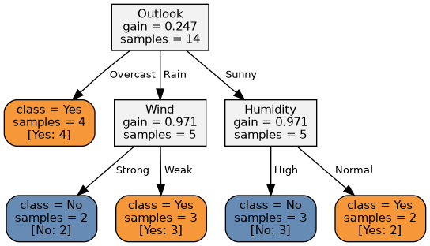

# 🌳 Decision Tree Classification System

Interactive Streamlit app that trains **ID3** and **C4.5** decision trees (implemented from scratch with
NumPy/Pandas), draws the trees with **Graphviz**, evaluates them with scikit-learn metrics and compares the two algorithms.



## Features
| Step | What the app does |
|---|---|
| Upload | Any classification CSV (delimiter auto-detected) or one of 3 bundled samples |
| Target | Choose the class column; class-distribution chart and data summary |
| Preprocess | Drop columns (ID-like columns auto-flagged), impute or drop missing values, train/test split (stratified), numeric binning for ID3 |
| Train | ID3 (information gain) and C4.5 (gain ratio, continuous splits, pessimistic pruning) with depth / min-samples / min-gain controls |
| Visualise | Graphviz tree (collapsible depth), text rules, feature importance, DOT/PNG export |
| Evaluate | Confusion matrix, accuracy, precision, recall, F1 (macro / weighted), per-class table, predictions CSV, single-record prediction |
| Compare | Side-by-side metrics, bar charts, tree size, training time, prediction agreement |

## Quick start
```bash
git clone https://github.com/<your-username>/decision-tree-classifier.git
cd decision-tree-classifier
python -m venv .venv && source .venv/bin/activate      # Windows: .venv\Scripts\activate
pip install -r requirements.txt
streamlit run app.py
```
The Graphviz **binary** is only needed for PNG export (`sudo apt install graphviz`, `brew install graphviz`, or the
Windows installer). The on-screen tree renders without it.

Run the tests: `python -m pytest -q`

## Project layout
```
app.py                    Streamlit UI (5 tabs)
src/trees.py              ID3 + C4.5 implementations
src/preprocessing.py      cleaning, imputation, binning, splitting
src/evaluation.py         metrics + comparison table
src/visualization.py      Graphviz tree, Matplotlib charts
data/                     sample CSVs + generator script
tests/test_core.py        unit tests (textbook ID3 check, C4.5 splits, pipeline)
docs/DOCUMENTATION.md     full documentation (theory, design, usage, Git workflow)
```

## Algorithms in one minute
* **ID3** – categorical attributes, multiway split on the highest *information gain*; numeric columns are first discretised into bins.
* **C4.5** – picks the split with the highest *gain ratio* among attributes with at least average gain; numeric attributes use the best binary threshold; optional pessimistic error-based pruning.

See [docs/DOCUMENTATION.md](docs/DOCUMENTATION.md) for formulas, design decisions and limitations.
